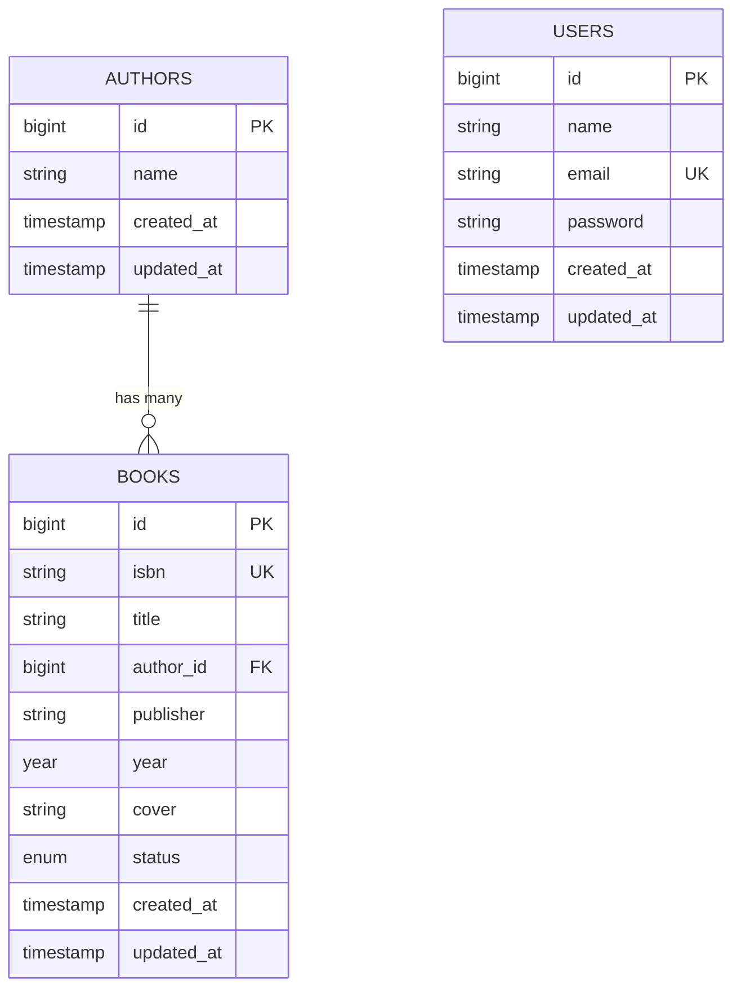

# 📘 Laporan Praktikum Pertemuan Ke - 6

🧑‍🎓 Herlyana Ferdiani - 4524210042

# 📚 Sistem Manajemen Buku (AuthBook) - Laravel 12 & Filament 3.x

Aplikasi Sistem Manajemen Buku (Katalog Perpustakaan) berbasis framework **Laravel 12** dan **Filament 3.x** yang mencakup fitur lengkap CRUD untuk mengelola data buku dan penulis (*author*), dilengkapi fitur pencarian (*search*), filter data, upload cover buku, pagination, serta otentikasi admin panel dan otorisasi menggunakan Policy.

<p align="center">
  
  
  
  
  
</p>

---

## 🚀 Instalasi & Menjalankan Proyek

### 1. Masuk ke Direktori Proyek
```bash
cd "Pertemuan 6/authbook"
```

### 2. Install Dependencies
```bash
# Install PHP dependencies via Composer
composer install

# Install Node dependencies
npm install
```

### 3. Setup Environment
```bash
# Salin template environment
cp .env.example .env

# Generate application encryption key
php artisan key:generate
```

### 4. Setup Database & Seeding
```bash
# Buat file database SQLite jika belum ada
touch database/database.sqlite

# Jalankan migrasi dan isi database dengan data dummy
php artisan migrate:fresh --seed
```

### 5. Setup Storage Link
```bash
# Buat symbolic link agar upload cover buku dapat diakses publik
php artisan storage:link
```

### 6. Build Assets & Jalankan Development Server
```bash
# Build asset frontend
npm run build

# Jalankan server lokal Laravel
php artisan serve
```

Aplikasi admin panel Filament dapat diakses melalui browser di:
👉 **`http://localhost:8000/admin`**

**Kredensial Login Administrator Default:**
- **Email**: `admin@example.com`
- **Password**: `password`

---

## 📋 Daftar Isi

- [Tentang Aplikasi](#-tentang-aplikasi)
- [Filosofi Filament](#-filosofi-filament)
- [Tujuan Pembelajaran](#-tujuan-pembelajaran)
- [Fitur Utama](#-fitur-utama)
- [Tech Stack](#-tech-stack)
- [Struktur Database & Relasi](#-struktur-database--relasi)
- [Langkah-Langkah Implementasi](#-langkah-langkah-implementasi)
- [Dokumentasi Tugas 1: Implementasi Dasar](#-dokumentasi-tugas-1-implementasi-dasar)

---

## 🎯 Tentang Aplikasi

Aplikasi **AuthBook** adalah sistem back-office / admin panel modern yang dibangun dengan **Laravel 12** dan **Filament 3.x**. Aplikasi ini dirancang untuk mempermudah pustakawan atau administrator dalam mengelola inventaris buku dan data penulis secara efisien. Dengan memanfaatkan ekosistem deklaratif Filament, antarmuka admin yang responsif, dinamis, dan terstruktur dapat dihasilkan secara cepat dan elegan.

---

## 💡 Filosofi Filament

Filament adalah framework admin panel yang dibangun di atas fondasi Laravel, Livewire, Alpine.js, dan Tailwind CSS (TALL Stack). Filosofi utama Filament mengusung prinsip:

> *"Make the common things easy, and the hard things possible"*

1. **Rapid Application Development (RAD)**: Memungkinkan pembuatan admin panel berfitur lengkap dalam hitungan menit secara deklaratif tanpa menulis boilerplate UI/HTML yang berulang.
2. **Full-Stack Components**: Menyediakan komponen bawaan yang sangat kaya, mulai dari *Forms*, *Tables*, *Infolists*, *Actions*, *Notifications*, hingga *Widgets*.
3. **Convention over Configuration**: Mengikuti konvensi Laravel standar sehingga memangkas waktu setup dan meminimalkan kesalahan konfigurasi.
4. **Modern Stack**: Dibangun di atas Laravel, Livewire 3 (interaktivitas tanpa menulis JavaScript manual), Alpine.js, dan Tailwind CSS.
5. **Developer Experience (DX)**: Menawarkan API yang intuitif, dukungan penuh terhadap *type-hinting* PHP, dan integrasi yang rapi dengan Eloquent ORM.

---

## 🎓 Tujuan Pembelajaran

Setelah menyelesaikan praktikum pertemuan ke-6 ini, capaian pembelajaran yang diperoleh meliputi:
1. ✅ Memahami konsep MVC (*Model-View-Controller*) dalam ekosistem Laravel.
2. ✅ Memahami filosofi, arsitektur, dan implementasi Filament 3.x untuk admin panel.
3. ✅ Membuat dan mengelola *database migrations* dengan foreign key constraint.
4. ✅ Membangun model Eloquent dengan relasi *One-to-Many* (`Author` hasMany `Book`, `Book` belongsTo `Author`).
5. ✅ Mengimplementasikan CRUD lengkap menggunakan *Filament Resources*.
6. ✅ Membangun form deklaratif dengan validasi ketat dan komponen relasi interaktif.
7. ✅ Mengimplementasikan manajemen upload file gambar dan konfigurasi *storage link*.
8. ✅ Mengonfigurasi fitur pencarian (*searchable*) dan penyaringan (*filtering*) data pada tabel.
9. ✅ Menggunakan *Factory* dan *Seeder* untuk menghasilkan data dummy otomatis.
10. ✅ Menerapkan otorisasi hak akses (*authorization*) menggunakan Laravel Policies.

---

## ✨ Fitur Utama

- 🔐 **Otentikasi Admin Panel**: Halaman login terproteksi khusus administrator.
- 👥 **Manajemen Penulis (Author Resource)**:
  - CRUD data penulis.
  - Agregasi jumlah buku yang ditulis (`counts('books')`).
  - Pencarian dan pengurutan (*sorting*) berdasarkan nama penulis.
- 📖 **Manajemen Buku (Book Resource)**:
  - CRUD data buku lengkap (ISBN, Judul, Penulis, Penerbit, Tahun, Status, Cover).
  - Relasi dinamis ke model `Author` dengan fitur pencarian dan pembuatan penulis baru secara langsung (*inline form creation*).
  - Status ketersediaan buku (*Available* / *Borrowed*) dengan visual badge berwarna.
  - Upload file cover buku dengan pembatasan ukuran (maksimal 2MB) dan format (JPEG, PNG, WebP).
- 🔍 **Pencarian Real-Time (Search)**: Pencarian cepat berdasarkan ISBN, judul buku, nama penulis, dan penerbit.
- 🎯 **Multi-Filtering Table**: Filter data buku berdasarkan status ketersediaan (*available/borrowed*), tahun terbit, serta nama penulis.
- 📄 **Detail View (Infolist)**: Halaman detail buku berformat *read-only* yang rapi dan terstruktur.
- 🛡️ **Kebijakan Keamanan (Policies)**: Pengendalian otorisasi akses CRUD melalui `BookPolicy` dan `AuthorPolicy`.

---

## 🛠️ Tech Stack

### Backend & Framework
- **PHP**: `^8.2`
- **Laravel Framework**: `12.x`
- **Filament PHP**: `3.x` (Admin Panel, Forms, Tables, Infolists)
- **SQLite**: Database file-based yang ringan dan praktis untuk pengembangan
- **Eloquent ORM**: Object-Relational Mapping

### Frontend & UI
- **Livewire**: `3.x` - Komponen reaktif full-stack
- **Tailwind CSS**: Utility-first CSS framework untuk admin styling
- **Alpine.js**: Interaktivitas sisi klien ringan
- **Vite**: `7.0` - Asset bundler modern

---

## 🗄️ Struktur Database & Relasi

Aplikasi ini menggunakan relasi **One-to-Many** antara penulis (*Author*) dan buku (*Book*):
- Satu penulis (*Author*) dapat memiliki banyak buku (*Books*).
- Setiap buku (*Book*) merujuk pada satu penulis (*Author*) melalui foreign key `author_id` dengan aturan `onDelete('cascade')`.



---

## 🚀 Langkah-Langkah Implementasi

1. **Inisialisasi Proyek & Paket Filament**:
   - Membuat proyek Laravel 12 dan menginstal paket `filament/filament:^3.0`.
   - Mengonfigurasi panel admin default melalui `php artisan filament:install --panels`.
2. **Perancangan Model & Migrasi**:
   - Membuat model dan migration untuk `Author` (`php artisan make:model Author -m`).
   - Membuat model dan migration untuk `Book` (`php artisan make:model Book -m`) dengan kolom relasi `author_id`.
   - Mendefinisikan relasi `hasMany` pada `Author` dan `belongsTo` pada `Book`.
3. **Pembuatan Factory & Seeder**:
   - Membuat `AuthorFactory` dan `BookFactory` memanfaatkan pustaka Faker.
   - Mengonfigurasi `DatabaseSeeder` untuk membuat 1 akun admin default, 10 data penulis acak, dan 50 data buku terkait.
   - Menjalankan `php artisan migrate:fresh --seed` serta membuat symlink storage (`php artisan storage:link`).
4. **Membangun Filament Resources**:
   - Membuat resource `AuthorResource` dan `BookResource` (`--generate --view`).
   - Mengonfigurasi skema form input (TextInput, Select relasi dengan `createOptionForm`, FileUpload cover, dsb).
   - Mengonfigurasi tabel data (TextColumn, BadgeColumn, ImageColumn, filter status/tahun/author, dan action tombol).
   - Mengonfigurasi halaman detail `ViewBook` menggunakan Infolist.
5. **Penerapan Authorization Policies**:
   - Membuat `BookPolicy` dan `AuthorPolicy` untuk menjamin keamanan hak akses operasi data pada panel admin.
6. **Pengujian Fungsional**:
   - Pengujian proses login admin, verifikasi data hasil seeder, pembuatan data buku baru, pengujian pencarian (*search*), dan pengujian penyaringan (*filter*).

---

## 📸 Dokumentasi Tugas 1: Implementasi Dasar (Nilai: 40)

Sesuai instruksi modul praktikum, berikut adalah bukti implementasi seluruh langkah praktikum dasar:

- [x] Screenshot admin panel yang berhasil login
- [x] Screenshot list books dengan data yang terseed
- [x] Screenshot form create book
- [x] Screenshot hasil pencarian
- [x] Screenshot filter aktif

---

### 1. Screenshot Admin Panel yang Berhasil Login
Menampilkan antarmuka Dashboard Admin Filament setelah berhasil melakukan otentikasi login menggunakan akun administrator (`admin@example.com`).


---

### 2. Screenshot List Books dengan Data yang Terseed
Menampilkan tabel daftar buku pada menu **Books** yang berhasil terisi data dummy sebanyak 50 buku dan 10 penulis hasil eksekusi *Database Seeder*, lengkap dengan informasi cover, ISBN, judul buku, nama penulis, tahun terbit, dan status ketersediaan.


---

### 3. Screenshot Form Create Book
Menampilkan formulir tambah buku baru (*New Book*) yang mencakup input ISBN, Title, Author (dropdown relasi interaktif yang mendukung pencarian serta penambahan penulis baru secara inline), Publisher, Year, Status, dan area upload Cover Image.


---

### 4. Screenshot Hasil Pencarian (Search)
Menampilkan fungsionalitas pencarian (*search bar*) real-time pada tabel buku yang secara dinamis menyaring baris data sesuai kata kunci pencarian yang dimasukkan pengguna.


---

### 5. Screenshot Filter Aktif
Menampilkan fungsionalitas penyaringan (*filter*) tabel yang sedang aktif (seperti penyaringan berdasarkan status ketersediaan buku maupun kriteria lainnya) untuk mempermudah navigasi data dalam jumlah besar.


---

<p align="center">
  Dibuat dengan ❤️ oleh <b>Herlyana Ferdiani (4524210042)</b><br>
  Praktikum Pemrograman Berbasis Web - Pertemuan 6
</p>
