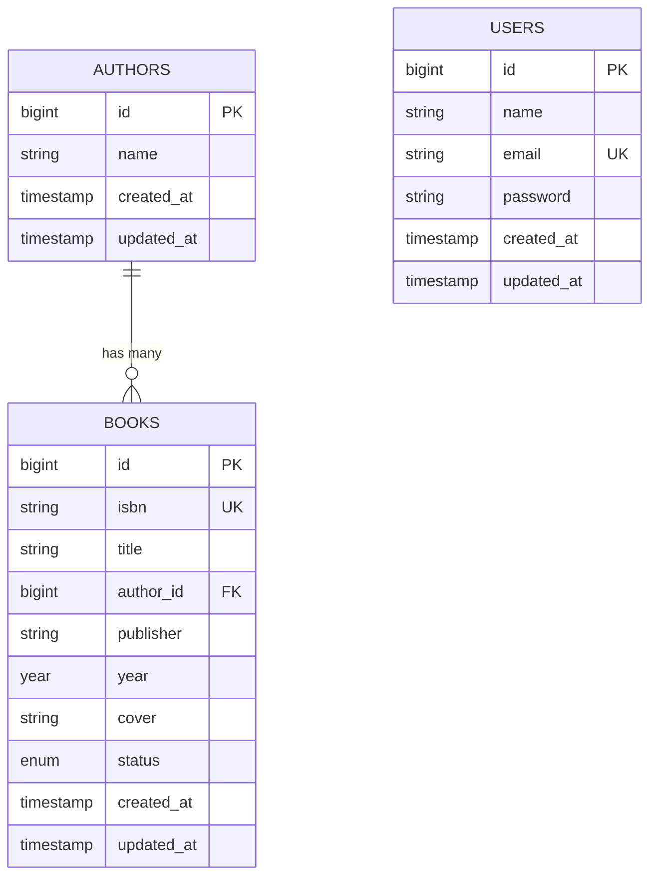
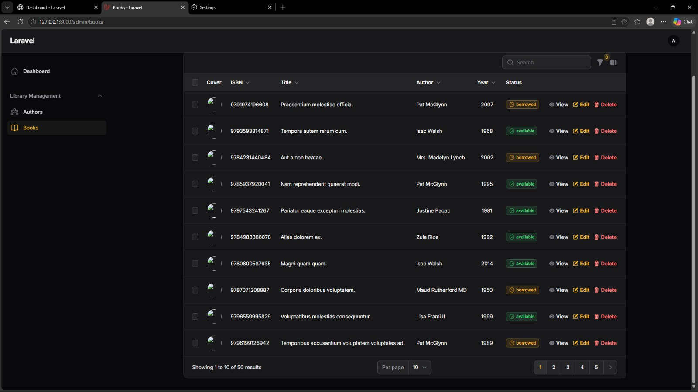
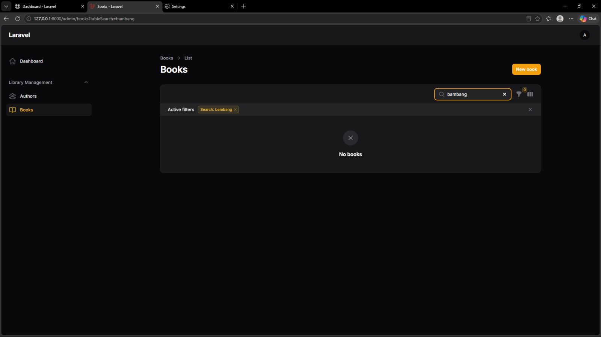
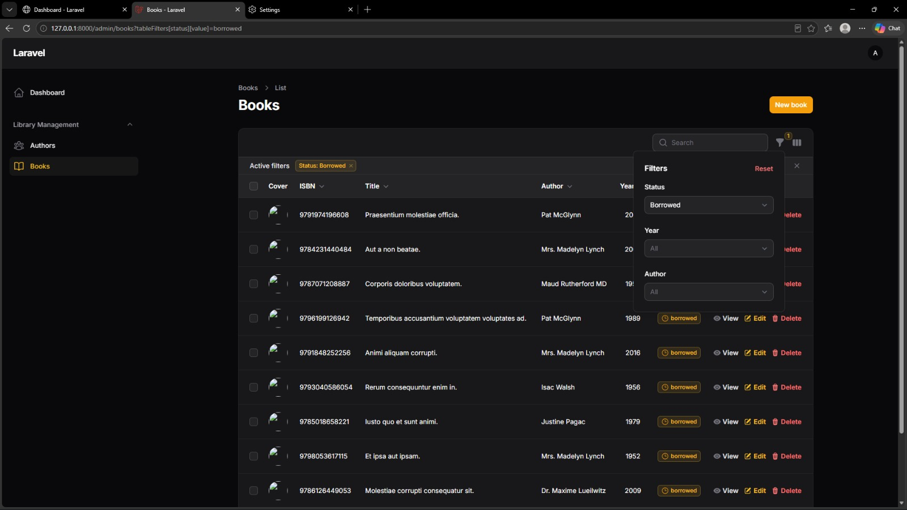

# 📘 Laporan Praktikum Pertemuan Ke - 6

🧑‍🎓 Herlyana Ferdiani - 4524210042

# 📚 Sistem Manajemen Buku (AuthBook) - Laravel 12 & Filament 3.x

Aplikasi Sistem Manajemen Buku (Katalog Perpustakaan) berbasis framework **Laravel 12** dan **Filament 3.x** yang mencakup fitur lengkap CRUD untuk mengelola data buku dan penulis (*author*), dilengkapi fitur pencarian (*search*), filter multi-kriteria, upload cover buku, pagination, serta otentikasi admin panel dan otorisasi menggunakan Policy.

<p align="center">
  
  
  
  
  
</p>

---

## ⚡ Quick Start: Panduan Menjalankan Proyek

```bash
# 1. Masuk ke direktori proyek authbook
cd "Pertemuan 6/authbook"

# 2. Install dependencies PHP & Node
composer install
npm install

# 3. Setup environment
cp .env.example .env
php artisan key:generate

# 4. Inisialisasi database SQLite & jalankan seeder dummy
touch database/database.sqlite
php artisan migrate:fresh --seed

# 5. Buat symbolic link untuk upload gambar
php artisan storage:link

# 6. Build assets & jalankan server lokal
npm run build
php artisan serve
```

Aplikasi admin panel Filament dapat diakses melalui browser di:
👉 **`http://localhost:8000/admin`**

**Kredensial Login Administrator Default:**
- **Email**: `admin@example.com`
- **Password**: `password`

---

## 📋 Daftar Isi

- [Tentang Aplikasi](#-tentang-aplikasi)
- [Filosofi Filament](#-filosofi-filament)
- [Tujuan Pembelajaran](#-tujuan-pembelajaran)
- [Fitur Utama](#-fitur-utama)
- [Tech Stack](#-tech-stack)
- [Struktur Database & Relasi](#-struktur-database--relasi)
- [Langkah-Langkah Praktikum (Lengkap)](#-langkah-langkah-praktikum-lengkap)
  - [BAGIAN 1: Setup Project Laravel & Filament](#bagian-1-setup-project-laravel--filament)
  - [BAGIAN 2: Membuat Model, Relasi, dan Database Migrations](#bagian-2-membuat-model-relasi-dan-database-migrations)
  - [BAGIAN 3: Membuat Factory dan Database Seeder](#bagian-3-membuat-factory-dan-database-seeder)
  - [BAGIAN 4: Membangun Filament Resources (Author & Book)](#bagian-4-membangun-filament-resources-author--book)
  - [BAGIAN 5: Penerapan Authorization dengan Policies](#bagian-5-penerapan-authorization-dengan-policies)
  - [BAGIAN 6: Membuat Admin User dan Pengujian Operasi CRUD](#bagian-6-membuat-admin-user-dan-pengujian-operasi-crud)
  - [BAGIAN 7: Verifikasi dan Optimasi Sistem](#bagian-7-verifikasi-dan-optimasi-sistem)
- [Dokumentasi Tugas 1: Implementasi Dasar](#-dokumentasi-tugas-1-implementasi-dasar)
- [Troubleshooting](#-troubleshooting)

---

## 🎯 Tentang Aplikasi

Aplikasi **AuthBook** adalah sistem *back-office* / *admin panel* modern yang dibangun menggunakan framework **Laravel 12** dan **Filament 3.x**. Aplikasi ini mempermudah pustakawan atau administrator dalam mengelola data buku dan penulis (*author*) secara efisien. Dengan memanfaatkan ekosistem deklaratif Filament, antarmuka admin yang responsif, dinamis, dan terstruktur dapat dihasilkan secara cepat dan elegan.

---

## 💡 Filosofi Filament

Filament adalah framework admin panel yang dibangun di atas fondasi Laravel, Livewire, Alpine.js, dan Tailwind CSS (TALL Stack). Filament dirancang dengan moto:

> *"Make the common things easy, and the hard things possible"*

1. **Rapid Application Development (RAD)**: Memungkinkan developer membangun admin panel yang kompleks dalam hitungan menit secara deklaratif.
2. **Full-Stack Components**: Ekosistem terintegrasi yang mencakup *Forms* (validasi otomatis), *Tables* (sorting, filtering, searching), *Actions*, *Notifications*, *Widgets*, dan *Infolists*.
3. **Convention over Configuration**: Mengikuti konvensi Laravel standar sehingga memangkas boilerplate code.
4. **Modern Stack**: Dibangun di atas Laravel 12, Livewire 3 (tanpa menulis JS manual), Alpine.js, dan Tailwind CSS.
5. **Developer Experience (DX)**: Menyediakan API yang intuitif, dokumentasi lengkap, *type safety* PHP, dan integrasi mulus dengan Eloquent ORM.

---

## 🎓 Tujuan Pembelajaran

Setelah menyelesaikan praktikum pertemuan ke-6 ini, mahasiswa diharapkan mampu:
1. ✅ Memahami konsep MVC (*Model-View-Controller*) dalam ekosistem Laravel.
2. ✅ Memahami filosofi dan kegunaan Filament dalam pengembangan aplikasi admin panel modern.
3. ✅ Membuat dan mengelola *database migrations* dengan relasi foreign key.
4. ✅ Membuat model Eloquent dengan relasi *One-to-Many* (`Author` hasMany `Book`, `Book` belongsTo `Author`).
5. ✅ Mengimplementasikan CRUD lengkap menggunakan *Filament Resources*.
6. ✅ Membangun form deklaratif dengan validasi ketat dan dropdown relasi interaktif (*inline option creation*).
7. ✅ Mengimplementasikan manajemen upload file gambar dan konfigurasi *storage link*.
8. ✅ Mengonfigurasi fitur pencarian (*searchable*) dan penyaringan (*filtering*) data pada tabel.
9. ✅ Menggunakan *Factory* dan *Seeder* untuk menghasilkan data dummy otomatis.
10. ✅ Menerapkan otorisasi hak akses (*authorization*) menggunakan Laravel Policies.

---

## ✨ Fitur Utama

- 🔐 **Otentikasi Admin Panel**: Autentikasi aman bawaan Filament khusus akun admin.
- 👥 **Manajemen Penulis (Author Resource)**:
  - CRUD data penulis.
  - Agregasi hitung jumlah buku yang ditulis (`counts('books')`).
  - Pencarian dan pengurutan (*sorting*) berdasarkan nama penulis.
- 📖 **Manajemen Buku (Book Resource)**:
  - CRUD data buku lengkap (ISBN, Judul, Penulis, Penerbit, Tahun, Status, Cover).
  - Relasi dinamis ke model `Author` dengan fitur pencarian dan pembuatan penulis baru secara langsung (*inline form creation*).
  - Status ketersediaan buku (*Available* / *Borrowed*) dengan visual badge berwarna.
  - Upload file cover buku dengan pembatasan ukuran (maksimal 2MB) dan format (JPEG, PNG, WebP).
- 🔍 **Pencarian Real-Time (Search)**: Pencarian instan pada tabel buku (ISBN, judul, nama penulis, penerbit).
- 🎯 **Multi-Filtering Table**: Filter data buku berdasarkan status ketersediaan, tahun terbit, serta nama penulis.
- 📄 **Detail View (Infolist)**: Halaman detail buku berformat *read-only* yang rapi dan terstruktur.
- 🛡️ **Kebijakan Keamanan (Policies)**: Pengendalian otorisasi akses CRUD melalui `BookPolicy` dan `AuthorPolicy`.

---

## 🛠️ Tech Stack

### Backend & Framework
- **PHP**: `^8.2`
- **Laravel Framework**: `12.x`
- **Filament PHP**: `3.x` (Admin Panel, Forms, Tables, Infolists)
- **SQLite**: Database file-based yang praktis dan terintegrasi
- **Eloquent ORM**: Object-Relational Mapping

### Frontend & UI
- **Livewire**: `3.x` - Reaktivitas full-stack
- **Tailwind CSS**: Utility-first CSS framework
- **Alpine.js**: Interaktivitas sisi klien ringan
- **Vite**: `7.0` - Asset bundler modern

---

## 🗄️ Struktur Database & Relasi

Aplikasi ini menggunakan relasi **One-to-Many** antara penulis (*Author*) dan buku (*Book*):
- Satu penulis (*Author*) dapat memiliki banyak buku (*Books*).
- Setiap buku (*Book*) merujuk pada satu penulis (*Author*) melalui foreign key `author_id` dengan aturan `onDelete('cascade')`.



---

## 🚀 Langkah-Langkah Praktikum (Lengkap)

Berikut adalah panduan teknis langkah demi langkah yang diimplementasikan sesuai modul praktikum:

### BAGIAN 1: Setup Project Laravel & Filament

#### Langkah 1.1: Membuat Project Laravel Baru
Membuat project Laravel baru dan menjalankan server pengujian:
```bash
# Buat project Laravel baru bernama authbook
composer create-project laravel/laravel authbook

# Masuk ke direktori project
cd authbook

# Jalankan development server untuk test
php artisan serve
```
> **Checkpoint**: Buka browser dan akses `http://localhost:8000`, pastikan halaman welcome Laravel muncul.

#### Langkah 1.2: Konfigurasi Database
Menggunakan SQLite sebagai database:
```bash
touch database/database.sqlite
```
Sesuaikan konfigurasi pada file `.env`:
```env
DB_CONNECTION=sqlite
# DB_HOST=127.0.0.1
# DB_PORT=3306
# DB_DATABASE=laravel
# DB_USERNAME=root
# DB_PASSWORD=
```

#### Langkah 1.3: Install Filament 3.x
Menginstal package Filament dan menginisialisasi panel admin:
```bash
# Install Filament via Composer
composer require filament/filament:"^3.0"

# Setup Filament panel admin
php artisan filament:install --panels
```
*Panel ID*: `admin` (tekan Enter untuk nilai default). Perintah ini akan menghasilkan file `app/Providers/Filament/AdminPanelProvider.php`.

---

### BAGIAN 2: Membuat Model, Relasi, dan Database Migrations

#### Langkah 2.1: Membuat Model Author
```bash
php artisan make:model Author -m
```

#### Langkah 2.2: Edit Migration Author
Buka file `database/migrations/xxxx_xx_xx_create_authors_table.php`:
```php
public function up(): void
{
    Schema::create('authors', function (Blueprint $table) {
        $table->id();
        $table->string('name');
        $table->timestamps();
    });
}
```

#### Langkah 2.3: Edit Model Author
Buka file `app/Models/Author.php` dan definisikan relasi `hasMany` ke model `Book`:
```php
<?php

namespace App\Models;

use Illuminate\Database\Eloquent\Factories\HasFactory;
use Illuminate\Database\Eloquent\Model;
use Illuminate\Database\Eloquent\Relations\HasMany;

class Author extends Model
{
    use HasFactory;

    protected $fillable = [
        'name',
    ];

    public function books(): HasMany
    {
        return $this->hasMany(Book::class);
    }
}
```

#### Langkah 2.4: Membuat Model Book
```bash
php artisan make:model Book -m
```

#### Langkah 2.5: Edit Migration Book
Buka file `database/migrations/xxxx_xx_xx_create_books_table.php`:
```php
public function up(): void
{
    Schema::create('books', function (Blueprint $table) {
        $table->id();
        $table->string('isbn')->unique();
        $table->string('title');
        $table->foreignId('author_id')->constrained()->onDelete('cascade');
        $table->string('publisher')->nullable();
        $table->year('year')->nullable();
        $table->string('cover')->nullable();
        $table->enum('status', ['available', 'borrowed'])->default('available');
        $table->timestamps();
    });
}
```
* **Penjelasan Field:**
  - `isbn`: Nomor identifikasi unik buku.
  - `title`: Judul buku.
  - `foreignId('author_id')->constrained()->onDelete('cascade')`: Foreign key relasi ke tabel `authors`.
  - `publisher`: Nama penerbit (nullable).
  - `year`: Tahun terbit (nullable).
  - `cover`: Path penyimpanan file gambar cover buku.
  - `status`: Enum status ketersediaan dengan nilai default `'available'`.

#### Langkah 2.6: Edit Model Book
Buka file `app/Models/Book.php` dan definisikan relasi `belongsTo` ke model `Author`:
```php
<?php

namespace App\Models;

use Illuminate\Database\Eloquent\Factories\HasFactory;
use Illuminate\Database\Eloquent\Model;
use Illuminate\Database\Eloquent\Relations\BelongsTo;

class Book extends Model
{
    use HasFactory;

    protected $fillable = [
        'isbn',
        'title',
        'author_id',
        'publisher',
        'year',
        'cover',
        'status',
    ];

    protected $casts = [
        'year' => 'integer',
    ];

    public function author(): BelongsTo
    {
        return $this->belongsTo(Author::class);
    }
}
```

#### Langkah 2.7: Menjalankan Migrasi
```bash
php artisan migrate
php artisan migrate:status
```

---

### BAGIAN 3: Membuat Factory dan Database Seeder

#### Langkah 3.1: Membuat Factory Author
```bash
php artisan make:factory AuthorFactory
```
Edit file `database/factories/AuthorFactory.php`:
```php
<?php

namespace Database\Factories;

use Illuminate\Database\Eloquent\Factories\Factory;

class AuthorFactory extends Factory
{
    public function definition(): array
    {
        return [
            'name' => fake()->name(),
        ];
    }
}
```

#### Langkah 3.2: Membuat Factory Book
```bash
php artisan make:factory BookFactory
```
Edit file `database/factories/BookFactory.php`:
```php
<?php

namespace Database\Factories;

use App\Models\Author;
use Illuminate\Database\Eloquent\Factories\Factory;

class BookFactory extends Factory
{
    public function definition(): array
    {
        return [
            'isbn' => fake()->unique()->isbn13(),
            'title' => fake()->sentence(3),
            'author_id' => Author::factory(),
            'publisher' => fake()->company(),
            'year' => fake()->numberBetween(1950, 2024),
            'status' => fake()->randomElement(['available', 'borrowed']),
        ];
    }
}
```

#### Langkah 3.3: Mengonfigurasi Database Seeder
Edit file `database/seeders/DatabaseSeeder.php`:
```php
<?php

namespace Database\Seeders;

use App\Models\Author;
use App\Models\Book;
use App\Models\User;
use Illuminate\Database\Seeder;

class DatabaseSeeder extends Seeder
{
    public function run(): void
    {
        // 1. Buat user admin default untuk Filament
        User::factory()->create([
            'name' => 'Admin User',
            'email' => 'admin@example.com',
        ]);

        // 2. Buat 10 data penulis (author)
        $authors = Author::factory(10)->create();

        // 3. Buat 50 data buku dengan relasi author acak
        Book::factory(50)->create([
            'author_id' => fn() => $authors->random()->id,
        ]);
    }
}
```

#### Langkah 3.4: Setup Storage Link
Membuat symlink dari `public/storage` ke `storage/app/public` untuk akses publik file upload cover:
```bash
php artisan storage:link
```

#### Langkah 3.5: Menjalankan Seeder
```bash
php artisan migrate:fresh --seed
```
> **Verifikasi via Tinker:**
> ```php
> php artisan tinker
> >>> App\Models\Author::count(); // Hasil: 10
> >>> App\Models\Book::count();   // Hasil: 50
> >>> exit;
> ```

---

### BAGIAN 4: Membangun Filament Resources (Author & Book)

#### Langkah 4.1: Membuat Author Resource
```bash
php artisan make:filament-resource Author --generate
```

#### Langkah 4.2: Kustomisasi Author Resource
Edit file `app/Filament/Resources/AuthorResource.php`:
```php
<?php

namespace App\Filament\Resources;

use App\Filament\Resources\AuthorResource\Pages;
use App\Models\Author;
use Filament\Forms;
use Filament\Forms\Form;
use Filament\Resources\Resource;
use Filament\Tables;
use Filament\Tables\Table;

class AuthorResource extends Resource
{
    protected static ?string $model = Author::class;

    protected static ?string $navigationIcon = 'heroicon-o-user-group';
    protected static ?string $navigationGroup = 'Library Management';

    public static function form(Form $form): Form
    {
        return $form
            ->schema([
                Forms\Components\Section::make('Author Information')
                    ->schema([
                        Forms\Components\TextInput::make('name')
                            ->required()
                            ->maxLength(255)
                            ->placeholder('Enter author name'),
                    ]),
            ]);
    }

    public static function table(Table $table): Table
    {
        return $table
            ->columns([
                Tables\Columns\TextColumn::make('id')
                    ->sortable(),
                
                Tables\Columns\TextColumn::make('name')
                    ->searchable()
                    ->sortable(),
                
                Tables\Columns\TextColumn::make('books_count')
                    ->counts('books')
                    ->label('Books')
                    ->sortable()
                    ->alignCenter(),
                
                Tables\Columns\TextColumn::make('created_at')
                    ->dateTime()
                    ->sortable()
                    ->toggleable(isToggledHiddenByDefault: true),
            ])
            ->filters([
                //
            ])
            ->actions([
                Tables\Actions\EditAction::make(),
                Tables\Actions\DeleteAction::make(),
            ])
            ->bulkActions([
                Tables\Actions\BulkActionGroup::make([
                    Tables\Actions\DeleteBulkAction::make(),
                ]),
            ])
            ->defaultSort('name', 'asc');
    }

    public static function getRelations(): array
    {
        return [];
    }

    public static function getPages(): array
    {
        return [
            'index' => Pages\ListAuthors::route('/'),
            'create' => Pages\CreateAuthor::route('/create'),
            'edit' => Pages\EditAuthor::route('/{record}/edit'),
        ];
    }
}
```

#### Langkah 4.3: Membuat Book Resource
```bash
php artisan make:filament-resource Book --generate --view
```

#### Langkah 4.4: Kustomisasi Book Resource
Edit file `app/Filament/Resources/BookResource.php`:
```php
<?php

namespace App\Filament\Resources;

use App\Filament\Resources\BookResource\Pages;
use App\Models\Book;
use Filament\Forms;
use Filament\Forms\Form;
use Filament\Resources\Resource;
use Filament\Tables;
use Filament\Tables\Table;

class BookResource extends Resource
{
    protected static ?string $model = Book::class;

    protected static ?string $navigationIcon = 'heroicon-o-book-open';
    protected static ?string $navigationGroup = 'Library Management';

    public static function form(Form $form): Form
    {
        return $form
            ->schema([
                Forms\Components\Section::make('Book Information')
                    ->schema([
                        Forms\Components\TextInput::make('isbn')
                            ->label('ISBN')
                            ->required()
                            ->unique(ignoreRecord: true)
                            ->maxLength(255),
                        
                        Forms\Components\TextInput::make('title')
                            ->required()
                            ->maxLength(255),
                        
                        Forms\Components\Select::make('author_id')
                            ->relationship('author', 'name')
                            ->searchable()
                            ->preload()
                            ->required()
                            ->createOptionForm([
                                Forms\Components\TextInput::make('name')
                                    ->required()
                                    ->maxLength(255),
                            ]),
                        
                        Forms\Components\TextInput::make('publisher')
                            ->maxLength(255),
                        
                        Forms\Components\TextInput::make('year')
                            ->numeric()
                            ->minValue(1000)
                            ->maxValue(date('Y'))
                            ->step(1),
                        
                        Forms\Components\Select::make('status')
                            ->options([
                                'available' => 'Available',
                                'borrowed' => 'Borrowed',
                            ])
                            ->required()
                            ->default('available'),
                    ])
                    ->columns(2),
                
                Forms\Components\Section::make('Cover Image')
                    ->schema([
                        Forms\Components\FileUpload::make('cover')
                            ->image()
                            ->directory('book-covers')
                            ->visibility('public')
                            ->imageEditor()
                            ->maxSize(2048)
                            ->acceptedFileTypes(['image/jpeg', 'image/png', 'image/webp'])
                            ->helperText('Maximum file size: 2MB. Accepted formats: JPEG, PNG, WebP'),
                    ]),
            ]);
    }

    public static function table(Table $table): Table
    {
        return $table
            ->columns([
                Tables\Columns\ImageColumn::make('cover')
                    ->circular()
                    ->defaultImageUrl(url('/images/default-book-cover.png')),
                
                Tables\Columns\TextColumn::make('isbn')
                    ->label('ISBN')
                    ->searchable()
                    ->sortable()
                    ->copyable(),
                
                Tables\Columns\TextColumn::make('title')
                    ->searchable()
                    ->sortable()
                    ->limit(50),
                
                Tables\Columns\TextColumn::make('author.name')
                    ->searchable()
                    ->sortable(),
                
                Tables\Columns\TextColumn::make('publisher')
                    ->searchable()
                    ->toggleable(isToggledHiddenByDefault: true),
                
                Tables\Columns\TextColumn::make('year')
                    ->sortable()
                    ->alignCenter(),
                
                Tables\Columns\BadgeColumn::make('status')
                    ->colors([
                        'success' => 'available',
                        'warning' => 'borrowed',
                    ])
                    ->icons([
                        'heroicon-o-check-circle' => 'available',
                        'heroicon-o-clock' => 'borrowed',
                    ]),
                
                Tables\Columns\TextColumn::make('created_at')
                    ->dateTime()
                    ->sortable()
                    ->toggleable(isToggledHiddenByDefault: true),
            ])
            ->filters([
                Tables\Filters\SelectFilter::make('status')
                    ->options([
                        'available' => 'Available',
                        'borrowed' => 'Borrowed',
                    ]),
                
                Tables\Filters\SelectFilter::make('year')
                    ->options(function () {
                        $currentYear = date('Y');
                        $years = [];
                        for ($year = $currentYear; $year >= 1950; $year--) {
                            $years[$year] = $year;
                        }
                        return $years;
                    })
                    ->searchable(),
                
                Tables\Filters\SelectFilter::make('author')
                    ->relationship('author', 'name')
                    ->searchable()
                    ->preload(),
            ])
            ->actions([
                Tables\Actions\ViewAction::make(),
                Tables\Actions\EditAction::make(),
                Tables\Actions\DeleteAction::make(),
            ])
            ->bulkActions([
                Tables\Actions\BulkActionGroup::make([
                    Tables\Actions\DeleteBulkAction::make(),
                ]),
            ])
            ->defaultSort('created_at', 'desc');
    }

    public static function getRelations(): array
    {
        return [];
    }

    public static function getPages(): array
    {
        return [
            'index' => Pages\ListBooks::route('/'),
            'create' => Pages\CreateBook::route('/create'),
            'view' => Pages\ViewBook::route('/{record}'),
            'edit' => Pages\EditBook::route('/{record}/edit'),
        ];
    }
}
```

#### Langkah 4.5: Kustomisasi Halaman Detail View Book (Infolist)
Edit file `app/Filament/Resources/BookResource/Pages/ViewBook.php`:
```php
<?php

namespace App\Filament\Resources\BookResource\Pages;

use App\Filament\Resources\BookResource;
use Filament\Actions;
use Filament\Infolists;
use Filament\Infolists\Infolist;
use Filament\Resources\Pages\ViewRecord;

class ViewBook extends ViewRecord
{
    protected static string $resource = BookResource::class;

    protected function getHeaderActions(): array
    {
        return [
            Actions\EditAction::make(),
            Actions\DeleteAction::make(),
        ];
    }

    public function infolist(Infolist $infolist): Infolist
    {
        return $infolist
            ->schema([
                Infolists\Components\Section::make('Book Details')
                    ->schema([
                        Infolists\Components\ImageEntry::make('cover')
                            ->height(200)
                            ->defaultImageUrl(url('/images/default-book-cover.png')),
                        
                        Infolists\Components\TextEntry::make('isbn')
                            ->label('ISBN')
                            ->copyable(),
                        
                        Infolists\Components\TextEntry::make('title')
                            ->size(Infolists\Components\TextEntry\TextEntrySize::Large)
                            ->weight('bold'),
                        
                        Infolists\Components\TextEntry::make('author.name')
                            ->label('Author'),
                        
                        Infolists\Components\TextEntry::make('publisher'),
                        
                        Infolists\Components\TextEntry::make('year'),
                        
                        Infolists\Components\TextEntry::make('status')
                            ->badge()
                            ->color(fn (string $state): string => match ($state) {
                                'available' => 'success',
                                'borrowed' => 'warning',
                            }),
                        
                        Infolists\Components\TextEntry::make('created_at')
                            ->dateTime(),
                        
                        Infolists\Components\TextEntry::make('updated_at')
                            ->dateTime(),
                    ])
                    ->columns(2),
            ]);
    }
}
```

---

### BAGIAN 5: Penerapan Authorization dengan Policies

#### Langkah 5.1: Membuat Policy untuk Book
```bash
php artisan make:policy BookPolicy --model=Book
```
Edit file `app/Policies/BookPolicy.php`:
```php
<?php

namespace App\Policies;

use App\Models\Book;
use App\Models\User;

class BookPolicy
{
    public function viewAny(User $user): bool
    {
        return true;
    }

    public function view(User $user, Book $book): bool
    {
        return true;
    }

    public function create(User $user): bool
    {
        return true;
    }

    public function update(User $user, Book $book): bool
    {
        return true;
    }

    public function delete(User $user, Book $book): bool
    {
        return true;
    }

    public function restore(User $user, Book $book): bool
    {
        return true;
    }

    public function forceDelete(User $user, Book $book): bool
    {
        return true;
    }
}
```

#### Langkah 5.2: Membuat Policy untuk Author
```bash
php artisan make:policy AuthorPolicy --model=Author
```
Edit file `app/Policies/AuthorPolicy.php` dengan implementasi yang sama (semua action mengembalikan nilai `true`).

---

### BAGIAN 6: Membuat Admin User dan Pengujian Operasi CRUD

#### Langkah 6.1: Membuat Admin User
Membuat user login admin baru melalui CLI Filament:
```bash
php artisan make:filament-user
```
Input yang dimasukkan:
- **Name**: `Admin`
- **Email**: `admin@example.com`
- **Password**: `password`

#### Langkah 6.2: Akses Admin Panel
Jalankan server aplikasi dan buka halaman login:
```bash
php artisan serve
```
1. Akses browser pada URL: `http://localhost:8000/admin/login`.
2. Masukkan email dan password admin yang telah dibuat.
3. Eksplorasi menu dan fitur dashboard Filament.

#### Langkah 6.3: Pengujian Fungsionalitas CRUD
1. **Create Book**: Klik menu **Books** > **New Book**, masukkan data buku baru (ISBN, judul, pilih/tambah author, penerbit, tahun, cover), lalu klik **Create**.
2. **Search**: Ketikkan kata kunci pada *search box* di tabel buku untuk menguji pencarian judul, ISBN, atau nama penulis secara instan.
3. **Filter**: Gunakan ikon filter pada pojok kanan atas tabel untuk menyaring berdasarkan status (Available/Borrowed), tahun terbit, atau nama penulis.
4. **Edit**: Klik ikon pensil (edit) pada salah satu buku untuk memperbarui data, lalu simpan perubahan.
5. **View Detail**: Klik ikon mata (view) untuk memeriksa tampilan detail buku berbasis Infolist.
6. **Delete & Bulk Action**: Uji penghapusan record tunggal dan penghapusan massal melalui opsi *Bulk Action Group*.

---

### BAGIAN 7: Verifikasi dan Optimasi Sistem

#### Langkah 7.1: Verifikasi Rute Admin
```bash
php artisan route:list --path=admin
```
Memastikan seluruh route bawaan Filament untuk AuthorResource dan BookResource telah terdaftar dengan benar.

#### Langkah 7.2: Verifikasi Database & Relasi via Tinker
```bash
php artisan db:show
php artisan tinker
```
```php
use App\Models\Author;
use App\Models\Book;

// Cek total data
Author::count();
Book::count();

// Cek relasi antar model
$author = Author::first();
$author->books; // Menampilkan seluruh buku milik author ini

$book = Book::first();
$book->author; // Menampilkan author pemilik buku ini

exit;
```

#### Langkah 7.3: Clear Cache Aplikasi
```bash
php artisan optimize:clear
```

---

## 📸 Dokumentasi Tugas 1: Implementasi Dasar (Nilai: 40)

Berdasarkan instruksi modul praktikum pada bagian **Tugas dan Evaluasi**, berikut adalah bukti implementasi seluruh langkah praktikum dasar:

- [x] Screenshot admin panel yang berhasil login
- [x] Screenshot list books dengan data yang terseed
- [x] Screenshot form create book
- [x] Screenshot hasil pencarian
- [x] Screenshot filter aktif

---

### 1. Screenshot Admin Panel yang Berhasil Login
Menampilkan antarmuka Dashboard Admin Filament setelah berhasil melakukan otentikasi login menggunakan akun administrator (`admin@example.com`).


---

### 2. Screenshot List Books dengan Data yang Terseed
Menampilkan tabel daftar buku pada menu **Books** yang berhasil terisi data dummy sebanyak 50 buku dan 10 penulis hasil eksekusi *Database Seeder*, lengkap dengan informasi cover, ISBN, judul buku, nama penulis, tahun terbit, dan status ketersediaan.



---

### 3. Screenshot Form Create Book
Menampilkan formulir tambah buku baru (*New Book*) yang mencakup input ISBN, Title, Author (dropdown relasi interaktif yang mendukung pencarian serta penambahan penulis baru secara inline), Publisher, Year, Status, dan area upload Cover Image.


---

### 4. Screenshot Hasil Pencarian (Search)
Menampilkan fungsionalitas pencarian (*search bar*) real-time pada tabel buku yang secara dinamis menyaring baris data sesuai kata kunci pencarian yang dimasukkan pengguna.



---

### 5. Screenshot Filter Aktif
Menampilkan fungsionalitas penyaringan (*filter*) tabel yang sedang aktif (seperti penyaringan berdasarkan status ketersediaan buku maupun kriteria lainnya) untuk mempermudah navigasi data dalam jumlah besar.



---

## 🔧 Troubleshooting

Jika menemui kendala saat instalasi atau menjalankan aplikasi, berikut solusi yang dapat diterapkan:

1. **Error: *Class 'App\Models\Book' not found***
   ```bash
   composer dump-autoload
   php artisan optimize:clear
   ```
2. **Error Migration: *Table already exists***
   ```bash
   php artisan migrate:fresh --seed
   ```
3. **Cover Image tidak muncul di browser (*Broken Link*)**
   ```bash
   php artisan storage:link
   ```
4. **Filament 404 Not Found pada rute `/admin`**
   Pastikan `AdminPanelProvider` terdaftar di file `bootstrap/providers.php`:
   ```php
   App\Providers\Filament\AdminPanelProvider::class,
   ```

---

<p align="center">
  Dibuat dengan ❤️ oleh <b>Herlyana Ferdiani (4524210042)</b><br>
  Praktikum Pemrograman Berbasis Web - Pertemuan 6
</p>
