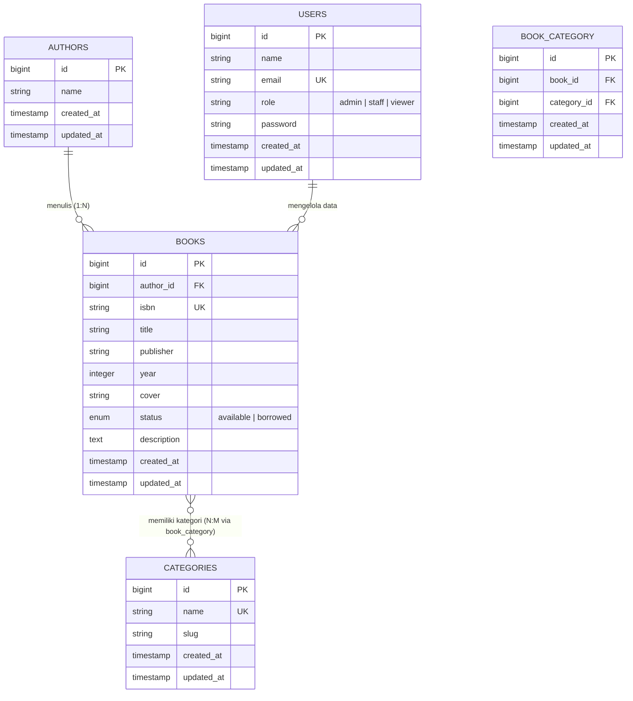
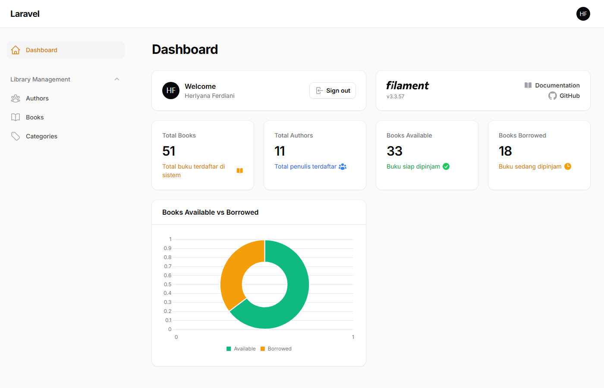
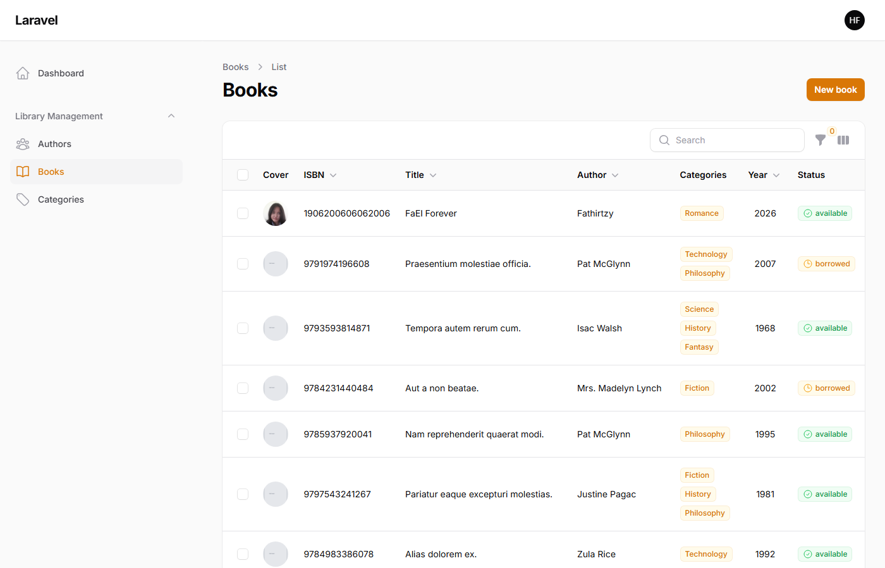
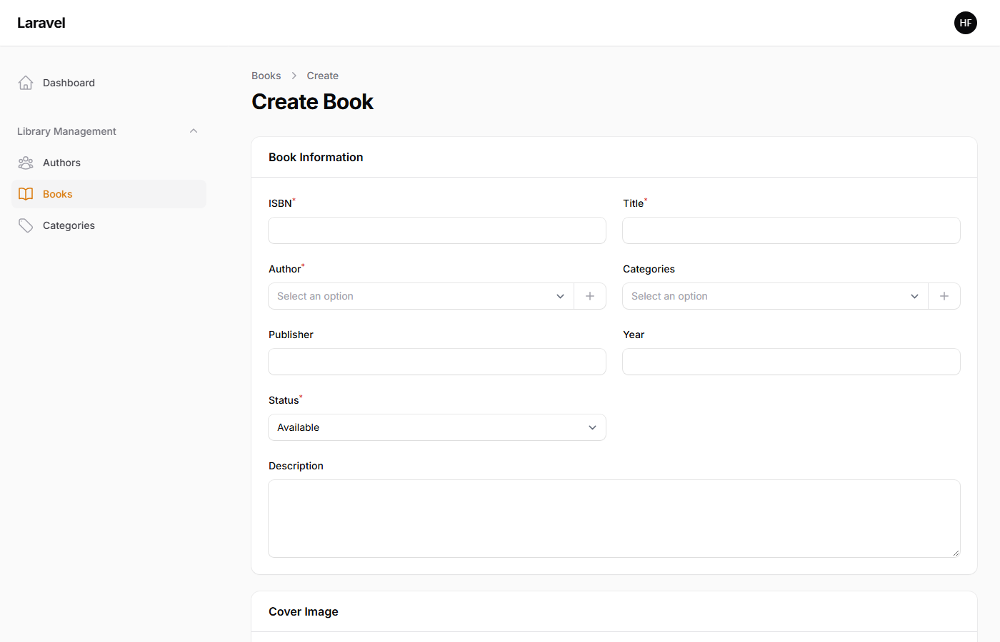
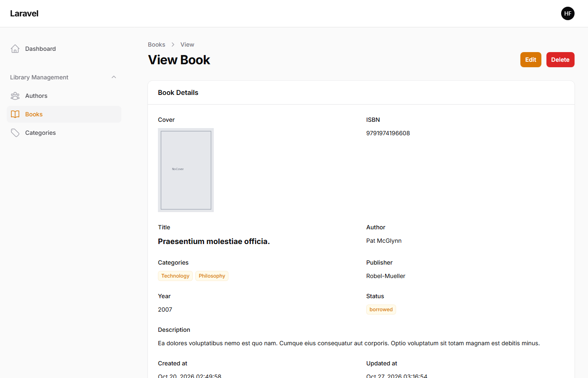
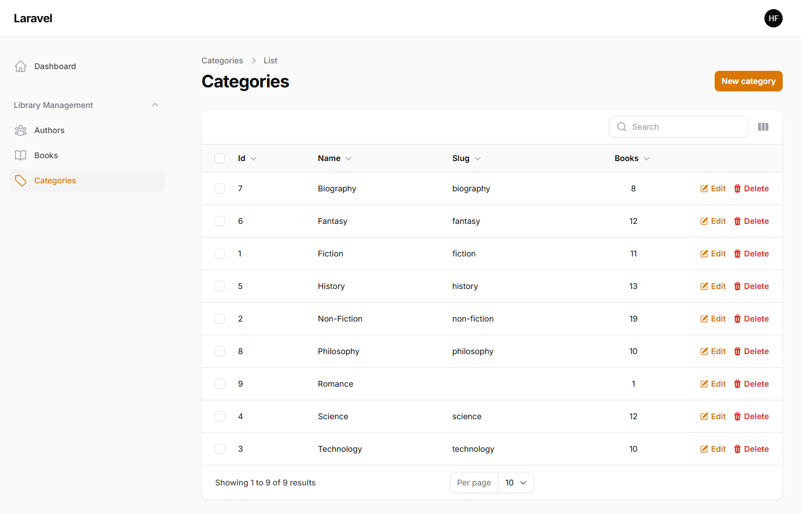
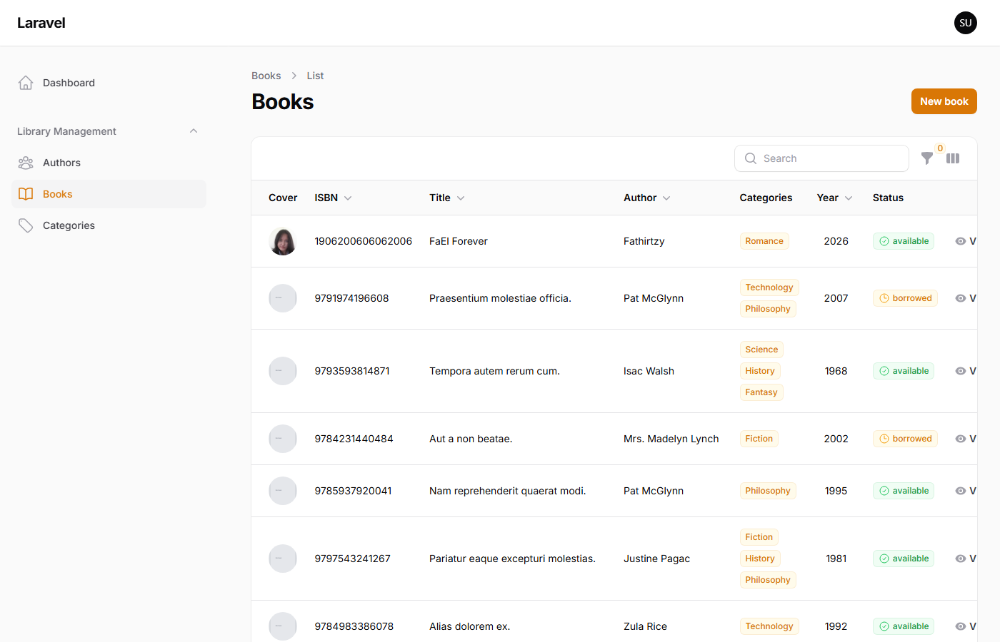
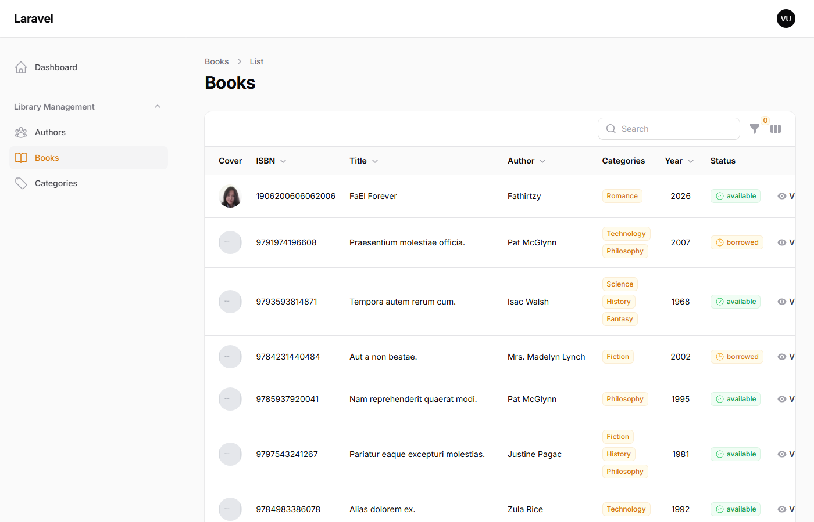

# 📘 Laporan Praktikum Pertemuan Ke - 7

🧑‍🎓 **Herlyana Ferdiani** — `4524210042`  
🏛️ **Program Studi**: Teknik Informatika  
💻 **Mata Kuliah**: Pemrograman Berbasis Web (Kelas A)  
🎯 **Fokus Materi**: Tugas 2 — Kustomisasi, Hak Akses RBAC, Widget Dashboard, & Relasi Many-to-Many pada Aplikasi AuthBook (Laravel 12 & Filament 3.x)  

---

# 📚 Sistem Informasi Manajemen Perpustakaan (AuthBook) — Tahap Kustomisasi & Ekstensi Fitur

Repositori ini memuat kelanjutan praktikum sistem **AuthBook** yang dibangun menggunakan kolaborasi **Laravel 12** dan **Filament 3.x**. Dokumen ini secara khusus mendokumentasikan implementasi menyeluruh dari **Tugas 2: Kustomisasi dan Pengembangan (Nilai: 40 Poin)**, yang mencakup penambahan kolom deskripsi naratif buku, penerapan sistem hak akses bertingkat (*Role-Based Access Control*), visualisasi metrik data operasional pada dasbor Filament, serta relasi banyak-ke-banyak (*many-to-many*) antara buku dan kategori.

<p align="center">
  
  
  
  
  
</p>

---

## 🚀 Panduan Setup & Menjalankan Proyek Lokal

Gunakan instruksi terminal berikut untuk menguji dan menjalankan aplikasi di komputer lokal:

```bash
# Masuk ke folder proyek
cd "Pertemuan 7/authbook"

# Pasang paket Composer dan pustaka JavaScript
composer install
npm install

# Buat file konfigurasi lingkungan (.env)
cp .env.example .env
php artisan key:generate

# Inisialisasi basis data SQLite dan generate seluruh data dummy
touch database/database.sqlite
php artisan migrate:fresh --seed

# Hubungkan symbolic link penyimpanan media dan publikasikan aset Filament
php artisan storage:link
php artisan filament:assets

# Jalankan server pengembangan
php artisan serve
```

Buka browser dan kunjungi:  
👉 **`http://localhost:8000/admin`**

### 👥 Daftar Akun untuk Pengujian Multi-Peran (RBAC):
| Akun Pengguna | Email | Password | Tingkat Otoritas |
| :--- | :--- | :--- | :--- |
| **Super Admin** | `admin@example.com` | `password` | Kendali penuh (Lihat, Tambah, Sunting, Hapus record dan bulk actions). |
| **Staff Perpustakaan** | `staff@example.com` | `password` | Mengelola data buku & kategori (Bisa tambah & edit, dilarang menghapus). |
| **Viewer (Pengunjung)** | `viewer@example.com` | `password` | Hanya berhak membaca katalog buku (*read-only*), aksi modifikasi disembunyikan. |
| **Akun Pribadi Mahasiswa** | `erlyana0606@gmail.com` | `password` | Akun Administrator beridentitas **Herlyana Ferdiani**. |

---

## 📑 Sistematika Pembahasan Laporan

1. [Gambaran Umum Tugas 2](#-gambaran-umum-tugas-2)
2. [Arsitektur Data & Diagram Relasi ERD](#-arsitektur-data--diagram-relasi-erd)
3. [Langkah-Langkah Implementasi Tugas 2](#-langkah-langkah-implementasi-tugas-2)
   - [Poin A: Penambahan Kolom Description pada Buku (10 Poin)](#poin-a-penambahan-kolom-description-pada-buku-10-poin)
   - [Poin B: Penerapan Role-Based Access Control / RBAC (15 Poin)](#poin-b-penerapan-role-based-access-control--rbac-15-poin)
   - [Poin C: Perancangan Widget Dasbor Statistik & Grafik (10 Poin)](#poin-c-perancangan-widget-dasbor-statistik--grafik-10-poin)
   - [Poin D: Pengorganisasian Kategori Buku Many-to-Many (5 Poin)](#poin-d-pengorganisasian-kategori-buku-many-to-many-5-poin)
4. [Galeri Dokumentasi & Bukti Pengujian Antarmuka](#-galeri-dokumentasi--bukti-pengujian-antarmuka)
5. [Refleksi dan Evaluasi Pembelajaran](#-refleksi-dan-evaluasi-pembelajaran)

---

## 🌟 Gambaran Umum Tugas 2

Tugas 2 bertujuan menguji penguasaan teknik kustomisasi lanjutan pada aplikasi berbasis Laravel & Filament. Dari fitur dasar yang telah diselesaikan pada pertemuan sebelumnya, dilakukan 4 pengembangan strategis:
* **Pengayaan Detail Entitas**: Buku kini memiliki atribut naratif sinopsis panjang melalui field `description`.
* **Keamanan Sistem Bertingkat**: Penerapan otorisasi pengguna berdasarkan peran (*role*) yang terintegrasi langsung dengan `BookPolicy` sehingga aksi-aksi sensitif (seperti penghapusan buku) hanya dapat dilakukan oleh peran yang berwenang.
* **Dasbor Informatif**: Integrasi metrik visual langsung pada halaman muka panel admin menggunakan kartu ringkasan jumlah buku/penulis dan grafik donat status ketersediaan koleksi.
* **Relasi Majemuk (*N:M*)**: Pengelompokan buku ke dalam ragam kategori (*Categories*) menggunakan tabel perantara (*pivot table*) yang didukung komponen form *multiple-select*.

---

## 📊 Arsitektur Data & Diagram Relasi ERD

Skema basis data pada AuthBook v2.0 melibatkan relasi *One-to-Many* (Penulis ke Buku) dan *Many-to-Many* (Buku ke Kategori) yang dimodelkan sebagai berikut:



---

## 🛠️ Langkah-Langkah Implementasi Tugas 2

### Poin A: Penambahan Kolom Description pada Buku (10 Poin)

Fitur ini memungkinkan pengguna mencantumkan sinopsis atau deskripsi mendalam mengenai isi buku.

#### 1. Pembuatan Migration
Menjalankan migrasi penambahan kolom `description` pada tabel `books`:

*Berkas: `database/migrations/2026_10_27_000001_add_description_to_books_table.php`*
```php
<?php

use Illuminate\Database\Migrations\Migration;
use Illuminate\Database\Schema\Blueprint;
use Illuminate\Support\Facades\Schema;

return new class extends Migration
{
    public function up(): void
    {
        Schema::table('books', function (Blueprint $table) {
            $table->text('description')->nullable()->after('year');
        });
    }

    public function down(): void
    {
        Schema::table('books', function (Blueprint $table) {
            $table->dropColumn('description');
        });
    }
};
```

#### 2. Pendaftaran di Model Eloquent
Memperbarui properti `$fillable` pada berkas `app/Models/Book.php`:

```php
protected $fillable = [
    'isbn',
    'title',
    'author_id',
    'publisher',
    'year',
    'cover',
    'status',
    'description',
];
```

#### 3. Penyesuaian Form dan Infolist Resource
Menambahkan komponen `Textarea` pada formulir buku di `app/Filament/Resources/BookResource.php`:

```php
Forms\Components\Textarea::make('description')
    ->label('Description')
    ->rows(4)
    ->columnSpanFull(),
```

Serta menampilkan teks deskripsi saat mode pratinjau record di `app/Filament/Resources/BookResource/Pages/ViewBook.php`:

```php
Infolists\Components\TextEntry::make('description')
    ->label('Description')
    ->columnSpanFull(),
```

#### 4. Pembaruan Model Factory
Memastikan seeder dapat membangkitkan teks deskripsi secara otomatis menggunakan fungsi `fake()->paragraph()` di `database/factories/BookFactory.php`:

```php
public function definition(): array
{
    return [
        'isbn' => fake()->unique()->isbn13(),
        'title' => fake()->sentence(3),
        'author_id' => Author::factory(),
        'publisher' => fake()->company(),
        'year' => fake()->numberBetween(1950, 2024),
        'status' => fake()->randomElement(['available', 'borrowed']),
        'description' => fake()->paragraph(),
    ];
}
```

---

### Poin B: Penerapan Role-Based Access Control / RBAC (15 Poin)

Fitur ini mengatur hierarki hak akses pengguna agar sistem memiliki tata kelola keamanan yang kokoh.

#### 1. Migrasi Kolom Role pada Tabel Users
*Berkas: `database/migrations/2026_10_27_000002_add_role_to_users_table.php`*
```php
Schema::table('users', function (Blueprint $table) {
    $table->string('role')->default('viewer')->after('email');
});
```

#### 2. Penerapan Kontrak `FilamentUser` pada Model User
Pada `app/Models/User.php`, ditambahkan fungsi otorisasi panel admin dan fungsi pengecekan peran:

```php
namespace App\Models;

use Filament\Models\Contracts\FilamentUser;
use Filament\Panel;
use Illuminate\Foundation\Auth\User as Authenticatable;

class User extends Authenticatable implements FilamentUser
{
    protected $fillable = [
        'name',
        'email',
        'password',
        'role',
    ];

    public function canAccessPanel(Panel $panel): bool
    {
        return empty($this->role) || in_array($this->role, ['admin', 'staff', 'viewer']);
    }

    public function isAdmin(): bool
    {
        return $this->role === 'admin';
    }

    public function isStaff(): bool
    {
        return $this->role === 'staff';
    }

    public function isViewer(): bool
    {
        return $this->role === 'viewer';
    }
}
```

#### 3. Logika Otorisasi Kebijakan pada `BookPolicy.php`
Pengaturan izin aksi CRUD disusun sesuai ketentuan evaluasi pada `app/Policies/BookPolicy.php`:

```php
namespace App\Policies;

use App\Models\Book;
use App\Models\User;

class BookPolicy
{
    // Semua peran dapat membuka daftar buku
    public function viewAny(User $user): bool
    {
        return in_array($user->role, ['admin', 'staff', 'viewer']);
    }

    // Semua peran dapat melihat detail informasi buku
    public function view(User $user, Book $book): bool
    {
        return in_array($user->role, ['admin', 'staff', 'viewer']);
    }

    // Hanya Admin dan Staff yang boleh menambah buku baru
    public function create(User $user): bool
    {
        return in_array($user->role, ['admin', 'staff']);
    }

    // Hanya Admin dan Staff yang boleh memperbarui data buku
    public function update(User $user, Book $book): bool
    {
        return in_array($user->role, ['admin', 'staff']);
    }

    // HANYA Admin yang boleh menghapus data buku
    public function delete(User $user, Book $book): bool
    {
        return $user->role === 'admin';
    }

    // HANYA Admin yang boleh melakukan bulk delete
    public function deleteAny(User $user): bool
    {
        return $user->role === 'admin';
    }
}
```

---

### Poin C: Perancangan Widget Dasbor Statistik & Grafik (10 Poin)

Fitur ini menyajikan visualisasi ringkasan inventaris buku di halaman depan admin panel.

#### 1. Widget Statistik Ringkas (*Stats Overview Widget*)
*Berkas: `app/Filament/Widgets/BookStatsOverviewWidget.php`*
Menampilkan 4 kartu ringkasan kuantitas koleksi:

```php
namespace App\Filament\Widgets;

use App\Models\Author;
use App\Models\Book;
use Filament\Widgets\StatsOverviewWidget as BaseWidget;
use Filament\Widgets\StatsOverviewWidget\Stat;

class BookStatsOverviewWidget extends BaseWidget
{
    protected static bool $isLazy = false;
    protected static ?int $sort = 1;

    protected function getStats(): array
    {
        $totalBooks = Book::count();
        $totalAuthors = Author::count();
        $availableBooks = Book::where('status', 'available')->count();
        $borrowedBooks = Book::where('status', 'borrowed')->count();

        return [
            Stat::make('Total Books', $totalBooks)
                ->description('Total buku terdaftar di sistem')
                ->descriptionIcon('heroicon-m-book-open')
                ->color('primary'),

            Stat::make('Total Authors', $totalAuthors)
                ->description('Total penulis terdaftar')
                ->descriptionIcon('heroicon-m-user-group')
                ->color('info'),

            Stat::make('Books Available', $availableBooks)
                ->description('Buku siap dipinjam')
                ->descriptionIcon('heroicon-m-check-circle')
                ->color('success'),

            Stat::make('Books Borrowed', $borrowedBooks)
                ->description('Buku sedang dipinjam')
                ->descriptionIcon('heroicon-m-clock')
                ->color('warning'),
        ];
    }
}
```

#### 2. Widget Grafik Donat Interaktif (*Chart Widget*)
*Berkas: `app/Filament/Widgets/BookStatusChartWidget.php`*
Menampilkan visualisasi rasio buku yang siap dipinjam vs yang sedang dipinjam:

```php
namespace App\Filament\Widgets;

use App\Models\Book;
use Filament\Widgets\ChartWidget;

class BookStatusChartWidget extends ChartWidget
{
    protected static bool $isLazy = false;
    protected static ?string $heading = 'Books Available vs Borrowed';
    protected static ?int $sort = 2;
    protected static ?string $maxHeight = '280px';

    protected function getData(): array
    {
        $available = Book::where('status', 'available')->count();
        $borrowed = Book::where('status', 'borrowed')->count();

        return [
            'datasets' => [
                [
                    'label' => 'Total Books',
                    'data' => [$available, $borrowed],
                    'backgroundColor' => [
                        '#10B981', // Hijau (Available)
                        '#F59E0B', // Oranye (Borrowed)
                    ],
                ],
            ],
            'labels' => ['Available', 'Borrowed'],
        ];
    }

    protected function getType(): string
    {
        return 'doughnut';
    }
}
```

---

### Poin D: Pengorganisasian Kategori Buku Many-to-Many (5 Poin)

Fitur ini memfasilitasi klasifikasi buku ke dalam lebih dari satu kategori genre literatur.

#### 1. Migrasi Tabel Kategori & Tabel Perantara (Pivot)
* `database/migrations/2026_10_27_000003_create_categories_table.php`:
  ```php
  Schema::create('categories', function (Blueprint $table) {
      $table->id();
      $table->string('name')->unique();
      $table->string('slug')->nullable();
      $table->timestamps();
  });
  ```
* `database/migrations/2026_10_27_000004_create_book_category_table.php`:
  ```php
  Schema::create('book_category', function (Blueprint $table) {
      $table->id();
      $table->foreignId('book_id')->constrained()->cascadeOnDelete();
      $table->foreignId('category_id')->constrained()->cascadeOnDelete();
      $table->timestamps();
      $table->unique(['book_id', 'category_id']);
  });
  ```

#### 2. Relasi Eloquent Many-to-Many
* Pada model `app/Models/Category.php`:
  ```php
  public function books(): BelongsToMany
  {
      return $this->belongsToMany(Book::class);
  }
  ```
* Pada model `app/Models/Book.php`:
  ```php
  public function categories(): BelongsToMany
  {
      return $this->belongsToMany(Category::class);
  }
  ```

#### 3. Pemilihan Kategori Ganda pada Formulir Buku
Komponen `Select` ganda dengan pencarian instan dan pembuatan kategori baru langsung dari modal formulir disematkan pada `app/Filament/Resources/BookResource.php`:

```php
Forms\Components\Select::make('categories')
    ->label('Categories')
    ->relationship('categories', 'name')
    ->multiple()
    ->searchable()
    ->preload()
    ->createOptionForm([
        Forms\Components\TextInput::make('name')
            ->required()
            ->maxLength(255),
    ]),
```

Disertai pendaftaran kolom badge kategori pada tabel buku:
```php
Tables\Columns\TextColumn::make('categories.name')
    ->label('Categories')
    ->badge()
    ->separator(',')
    ->searchable(),
```

Serta modul pengelolaan kategori mandiri melalui `app/Filament/Resources/CategoryResource.php`.

---

## 📷 Galeri Dokumentasi & Bukti Pengujian Antarmuka

Berikut adalah bukti tangkapan layar pengujian fitur-fitur Tugas 2 yang telah berhasil berjalan secara sempurna:

### 1. Dasbor Utama dengan Widget Statistik & Chart Donat
Menampilkan 4 kartu ringkasan statistik dan grafik ketersediaan buku yang terotentikasi di bawah profil **Herlyana Ferdiani**:



---

### 2. Daftar Katalog Buku dengan Kolom Badge Kategori
Menampilkan tabel buku lengkap dengan badge kategori berwarna, status ketersediaan, serta data penerbit:



---

### 3. Formulir Buku Baru dengan Multiple Select & Textarea Description
Menampilkan field pemilih kategori majemuk (*multiple select*) dan input deskripsi naratif buku:



---

### 4. Detail Tampilan Buku (*Infolist View*)
Menampilkan pratinjau terstruktur dari data buku termasuk seluruh kategori yang tersemat dan paragraf deskripsi:



---

### 5. Modul Pengelolaan Data Kategori (*Category Management*)
Menampilkan halaman daftar kategori lengkap dengan perhitungan otomatis jumlah buku yang berelasi:



---

### 6. Uji Otoritas Hak Akses Peran Staff
Login menggunakan akun Staff (`staff@example.com`). Pengguna berhak menambah dan mengedit buku, namun **tombol hapus (Delete) disembunyikan**:



---

### 7. Uji Otoritas Hak Akses Peran Viewer
Login menggunakan akun Viewer (`viewer@example.com`). Pengguna hanya berstatus melihat katalog (*Read-Only*), semua tombol Create, Edit, dan Delete **dinonaktifkan**:



---

## 💡 Refleksi dan Evaluasi Pembelajaran

Melalui pengerjaan Tugas 2 ini, diperoleh wawasan mendalam mengenai kemudahan dan keunggulan ekosistem modern Laravel dan Filament:
1. **Pengembangan Cepat & Efisien (*RAD*)**: Filament memungkinkan pembuatan formulir kompleks dengan relasi *Many-to-Many* dan visualisasi grafik hanya melalui deklarasi PHP tanpa kerumitan JavaScript manual.
2. **Keamanan Bertingkat yang Andal**: Integrasi Laravel Policy secara deklaratif memberikan proteksi berlapis pada level antarmuka pengguna maupun logika backend.
3. **Penyajian Data Interaktif**: Penambahan widget dasbor memudahkan monitoring data agregat perpustakaan secara *real-time*.
