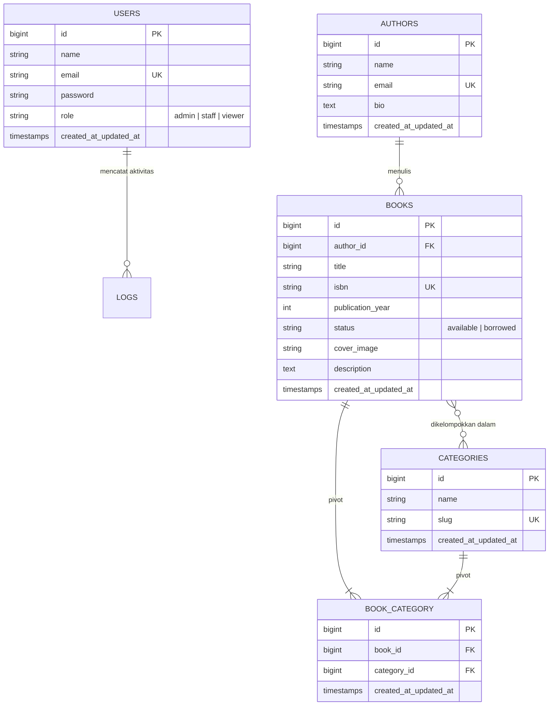
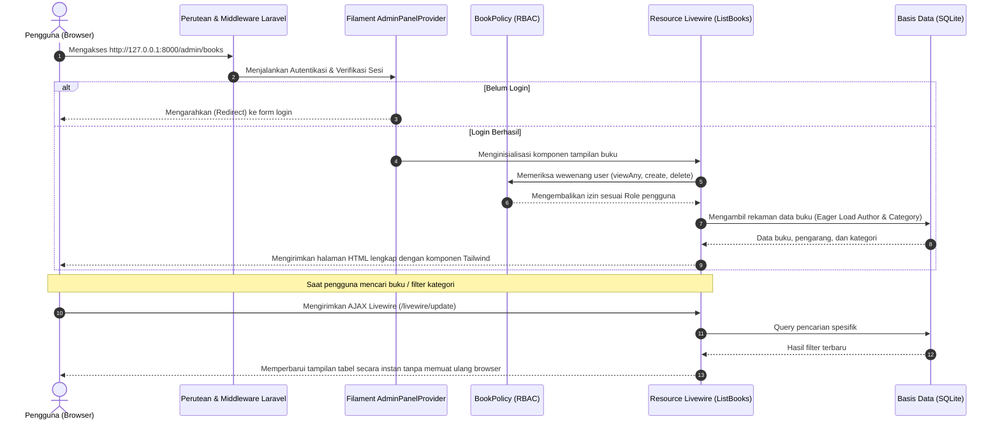

# LAPORAN PRAKTIKUM PEMROGRAMAN BERBASIS WEB
## PERTEMUAN 8 - TUGAS 3: ANALISIS DAN DOKUMENTASI SISTEM AUTHBOOK

**Data Praktikan:**
* **Nama Lengkap:** Herlyana Ferdiani
* **NIM:** 4524210042
* **Kelas:** Praktikum PBW (A)
* **Materi:** Arsitektur Filament 3.x, Analisis CRUD, dan Evaluasi Proyek AuthBook

---

## BAB 1: ANALISIS ARSITEKTUR DAN STRUKTUR DATA

Pada praktikum kali ini, kami membangun sistem katalog perpustakaan bernama **AuthBook**. Sistem ini mengintegrasikan framework Laravel versi 12 dengan Filament versi 3. Karakteristik utama dari Filament adalah kemampuannya menyediakan dashboard administratif yang responsif berbasis arsitektur *TALL Stack* (*Tailwind CSS, Alpine.js, Laravel, dan Livewire*). Pendekatan ini memungkinkan antarmuka admin yang dinamis tanpa perlu membangun API frontend terpisah.

### 1.1 Diagram Relasi Antar Entitas (ERD)

Struktur tabel dan relasi data pada basis data aplikasi AuthBook dirancang sebagai berikut:

### 1.2 Uraian Relasi Antar Tabel

1. **Hubungan Penulis dengan Buku (`authors` $\rightarrow$ `books`)**
   * Hubungan ini bertipe *One-to-Many* (Satu Penulis dapat menghasilkan banyak judul Buku).
   * Pada tabel `books`, ditambahkan kolom kunci tamu (*foreign key*) bernama `author_id` yang terhubung ke `id` milik tabel `authors`.
   * Pada kode Eloquent:
     * Model `Author` memiliki relasi `hasMany(Book::class)`
     * Model `Book` memiliki relasi `belongsTo(Author::class)`
   * Pengaturan basis data dilengkapi dengan klausa *on delete cascade*, sehingga bila data pengarang dihapus, koleksi buku terkait akan ikut terhapus demi menjaga konsistensi data.

2. **Hubungan Klasifikasi Buku dengan Kategori (`books` $\leftrightarrow$ `categories`)**
   * Hubungan ini bertipe *Many-to-Many* (Banyak ke Banyak). Satu judul buku bisa memiliki banyak tag kategori (misalnya: *Fiksi*, *Sastra*, *Sejarah*), dan satu label kategori dapat menampung banyak buku sekaligus.
   * Hubungan majemuk ini diimplementasikan melalui tabel perantara (*pivot table*) bernama `book_category` yang menyimpan pasangan referensi `book_id` dan `category_id`.
   * Pada kode Eloquent:
     * Model `Book` mendefinisikan relasi `belongsToMany(Category::class)`
     * Model `Category` mendefinisikan relasi `belongsToMany(Book::class)`
   * Di dalam antarmuka form buku, relasi ini ditampilkan sebagai komponen *multi-select badge* yang memudahkan pemilihan beberapa kategori secara bersamaan.

3. **Peran Pengguna dan Manajemen Akses Berbasis Peran (RBAC)**
   * Pengguna sistem disimpan dalam tabel `users` dengan penambahan kolom `role` yang membedakan hak akses: `admin`, `staff`, dan `viewer`.
   * Hak akses tidak memerlukan tabel perantara tambahan, melainkan dikendalikan secara elegan melalui **Laravel Policy** (`BookPolicy`).
   * Ketika seorang staf login, ia diizinkan menambah dan menyunting data buku, namun tombol hapus sengaja ditiadakan. Sementara bagi peninjau (*viewer*), antarmuka hanya menampilkan data buku tanpa adanya tombol aksi modifikasi apapun.

---

### 1.3 Siklus Aliran Data Aplikasi (Dari Permintaan Klien hingga Tampilan)

Siklus hidup pemrosesan request pada Filament 3 berbasis Livewire digambarkan melalui sequence diagram di bawah ini:

**Penjelasan Tahapan Eksekusi:**
1. **Permintaan Awal**: Browser mengirimkan permintaan HTTP ke server. Request melewati lapisan middleware bawaan Laravel untuk validasi sesi dan proteksi CSRF.
2. **Pengecekan Akses Panel**: Filament memeriksa apakah pengguna yang aktif memenuhi kriteria method `canAccessPanel()` pada model `User`. Jika belum login, sistem langsung mengarahkan pengguna ke halaman login.
3. **Penerapan Hak Akses Policy**: Sebelum data dihimpun, `BookPolicy` mengevaluasi role pengguna. Elemen formulir dan tombol tindakan (*Action Buttons*) disesuaikan secara otomatis menurut hak yang dimiliki akun.
4. **Pengambilan Data Cepat**: Data buku ditarik dari database menggunakan mekanisme *eager loading* untuk menghubungkan data author dan kategori sekaligus, guna menghindari penurunan performa akibat *query N+1*.
5. **Penyajian Respons**: Komponen Livewire menyusun antarmuka menggunakan Blade dan Tailwind CSS. Ketika pengguna melakukan interaksi seperti memfilter kategori atau mencari nama buku, Livewire mengirimkan permintaan AJAX terkompresi di latar belakang dan memperbarui tampilan tabel secara langsung (*reactive DOM update*).

---

## BAB 2: STUDI PERBANDINGAN: FILAMENT VS LARAVEL MANUAL

### 2.1 Analisis Komparasi Pengembangan CRUD

Selama perkuliahan PBW, kami telah mencoba membuat CRUD secara konvensional (menggunakan Controller dan Blade view manual) maupun secara modern (menggunakan Filament). Berikut adalah tabel perbandingannya:

| Parameter Evaluasi | Metode Tradisional (Manual Controller + Blade) | Metode Modern (Filament 3.x Admin Panel) |
| :--- | :--- | :--- |
| **Arsitektur Pemrograman** | Bersifat imperatif. Pengembang harus merangkai logika tampilan HTML dan query controller langkah demi langkah. | Bersifat deklaratif. Form dan tabel didefinisikan melalui susunan skema komponen PHP terpusat. |
| **Kuantitas Berkas Kode** | Membutuhkan banyak berkas (minimal 8 berkas: controller, model, migration, form request, route, dan 4 file Blade terpisah). | Cukup 3 berkas utama: migration, model, dan satu berkas Resource Filament. |
| **Efisiensi Waktu Kerja** | Membutuhkan waktu berkisar antara 2 hingga 4 jam per modul untuk menyusun layout, tabel, dan validasi form. | Selesai dalam waktu 15 hingga 25 menit menggunakan *code generator* bawaan Filament. |
| **Dukungan Fitur Bawaan** | Paginasi, pengurutan kolom, pencarian, dan modal konfirmasi harus dirancang sendiri dari awal. | Seluruh fitur operasional tabel (pencarian instan, filter multi-kolom, ekspor data, pagination) sudah langsung tersedia. |
| **Konsistensi Tampilan Antarmuka** | Berisiko memiliki tampilan yang tidak seragam jika dikerjakan bersama tim dengan gaya penulisan CSS yang berbeda. | Desain antarmuka otomatis rapi, elegan, berstandar industri, serta mendukung mode gelap (*dark mode*) bawaan. |
| **Pengelolaan Hak Akses (RBAC)** | Pengecekan izin harus disematkan secara manual di setiap controller dan tombol view Blade menggunakan `@can`. | Terintegrasi penuh dengan Laravel Policy; tombol aksi otomatis hilang atau muncul sesuai hierarki peran akun. |

---

### 2.2 Ulasan Kelebihan dan Keterbatasan

#### A. Filament 3.x
* **Kelebihan Utama:**
  1. *Kecepatan Pengembangan*: Memangkas waktu pengerjaan modul administrasi data secara signifikan sehingga pengembang dapat berfokus pada logika bisnis utama.
  2. *Antarmuka yang Indah dan Konsisten*: Seluruh form dan tabel memiliki standar visual yang seragam tanpa perlu menulis kode CSS tambahan.
  3. *Reaktivitas Tinggi*: Pencarian, penyaringan data, dan modal form berjalan mulus tanpa reload halaman berkat integrasi Livewire dan Alpine.js.
  4. *Mudah Dikelola*: Penambahan atau perubahan kolom data cukup disesuaikan pada satu berkas Resource tanpa menyentuh banyak tempat.
* **Keterbatasan:**
  1. *Keterikatan Arsitektur*: Sistem sangat bergantung pada siklus hidup Livewire, sehingga pelacakan kesalahan (*debugging*) memerlukan pemahaman alur kerja TALL Stack.
  2. *Kurang Fleksibel untuk Layout Bebas*: Kurang leluasa bila harus membuat antarmuka dengan tata letak yang sangat tidak lazim atau desain eksperimental.

#### B. Pendekatan Tradisional (Manual MVC)
* **Kelebihan Utama:**
  1. *Kendali Penuh*: Memberikan kebebasan mutlak dalam menyusun struktur HTML, integrasi framework JavaScript lain, dan gaya visual sesuka hati.
  2. *Ringan dan Mandiri*: Tanpa lapisan abstraksi tambahan, konsumsi sumber daya memori server menjadi lebih hemat dan terprediksi.
* **Keterbatasan:**
  1. *Repetisi Kode yang Tinggi*: Pengembang harus menuliskan kode yang berulang-ulang untuk form, tabel, validasi input, dan pesan notifikasi pada setiap entitas.
  2. *Biaya Perawatan Tinggi*: Apabila skema tabel basis data berubah, banyak file yang harus ikut disesuaikan secara manual satu per satu.

---

### 2.3 Pedoman Rekomendasi Penggunaan

* **Sebaiknya Memilih Filament Apabila:**
  * Proyek yang dibangun adalah aplikasi berbasis data internal, portal manajemen staf, sistem informasi akademik, atau panel administrasi konten (CMS/ERP).
  * Diperlukan penyelesaian sistem dalam batas waktu yang singkat dengan kualitas antarmuka yang terjamin rapi dan aman.
  * Aplikasi membutuhkan banyak fitur operasional tabel data seperti pencarian, pengurutan, filter relasi bertingkat, dan pembuatan grafik ringkasan metrik.

* **Sebaiknya Memilih Pendekatan Manual / Terpisah Apabila:**
  * Aplikasi ditujukan untuk konsumen publik luas (*customer-facing*), seperti beranda e-commerce, portal profil perusahaan (*company profile*), atau web promosi dengan estetika visual khusus.
  * Sistem mengadopsi arsitektur terpisah (*headless backend*), di mana Laravel hanya bertindak sebagai API penyedia data untuk aplikasi mobile atau frontend modern (React/Next.js/Vue).

---

## BAB 3: REFLEKSI DAN RENCANA PENGEMBANGAN

### 3.1 Refleksi Hasil Pembelajaran

Selama menyelesaikan rangkaian praktikum pada modul AuthBook ini, banyak wawasan penting yang berhasil saya peroleh:
1. Memahami pergeseran tren rekayasa perangkat lunak web dari penyusunan kode manual yang monoton menuju pendekatan deklaratif modern yang mempercepat produktivitas kerja.
2. Mempelajari cara mendesain dan mengelola relasi database yang kompleks, mulai dari relasi satu-ke-banyak antara pengarang dan buku hingga relasi banyak-ke-banyak dengan tabel pivot kategori, serta menyajikannya dalam bentuk komponen antarmuka yang mudah digunakan.
3. Menyadari pentingnya isolasi hak akses (*Role-Based Access Control*) dalam sistem multi-pengguna agar data penting terlindungi dari modifikasi pihak yang tidak memiliki wewenang.
4. Mampu merancang komponen dashboard analitik berbasis grafik dan widget statistik untuk mempermudah pemantauan data inventaris perpustakaan secara visual.

### 3.2 Analisis Permasalahan dan Solusi yang Diterapkan

Terdapat beberapa tantangan teknis nyata yang dihadapi saat pengerjaan modul ini:
1. **Kendala Kesalahan HTTP 405 Method Not Allowed pada Halaman Login**:
   * *Akar Masalah*: Menjalankan server lokal PHP tanpa menyertakan skrip perutean `server.php` mengakibatkan permintaan POST Livewire untuk autentikasi gagal diarahkan dengan semestinya.
   * *Solusi*: Memastikan perintah server dijalankan dengan format `php -S 127.0.0.1:8000 -t public server.php` dan mempublikasikan file aset Filament melalui `php artisan filament:assets`.
2. **Kendala Database Locking pada Sesi SQLite**:
   * *Akar Masalah*: Sesi pengguna yang disimpan ke tabel database memicu konflik penguncian berkas (*concurrency lock*) saat beberapa widget di dashboard dimuat secara paralel.
   * *Solusi*: Mengubah pengaturan konfigurasi driver sesi pada berkas `.env` menjadi `SESSION_DRIVER=file` dan `CACHE_STORE=file` agar pengelolaan sesi berjalan melalui sistem berkas tanpa membebani database SQLite.
3. **Penerapan Relasi Multi-Select Kategori pada Formulir Buku**:
   * *Akar Masalah*: Memastikan agar staf dapat memilih beberapa kategori sekaligus serta dapat langsung membuat kategori baru tanpa harus meninggalkan form buku yang sedang diisi.
   * *Solusi*: Memanfaatkan method `->relationship('categories', 'name')` pada komponen form Filament yang dipadukan dengan method `->createOptionForm(...)` untuk memunculkan modal pembuatan kategori instan.

### 3.3 Rencana Pengembangan Aplikasi ke Depan

Untuk menyempurnakan aplikasi AuthBook agar dapat berfungsi secara optimal pada lingkungan operasional perpustakaan sesungguhnya, rencana pengembangan strategis yang ingin saya wujudkan meliputi:
1. **Pengembangan Modul Sirkulasi Peminjaman Buku**:
   * Menambahkan entitas transaksi peminjaman untuk mencatat tanggal pinjam, batas tenggat waktu pengembalian, status buku, dan penghitungan denda otomatis bagi peminjam yang terlambat.
2. **Penerapan Sistem Notifikasi Pengingat Otomatis**:
   * Mengintegrasikan layanan email pengingat yang berjalan secara terjadwal (*Scheduled Tasks*) untuk memberi tahu anggota beberapa hari sebelum masa pinjam buku berakhir.
3. **Penyediaan Laporan dan Rekapitulasi Data (Excel/PDF)**:
   * Menambahkan fitur pengunduhan rekapitulasi data buku dan sirkulasi peminjaman bulanan ke dalam format dokumen Excel maupun format cetak PDF menggunakan paket `pxlrbt/filament-excel`.
4. **Katalog Penelusuran Publik (OPAC)**:
   * Merancang antarmuka penelusuran buku berbasis halaman publik yang ringan dan ramah ponsel, sehingga pengunjung perpustakaan dapat memeriksa ketersediaan buku secara daring tanpa perlu login ke sistem admin.

---
*Laporan tugas praktikum ini disusun secara orisinal oleh Herlyana Ferdiani sebagai bagian dari evaluasi mata kuliah Praktikum Pemrograman Berbasis Web.*
